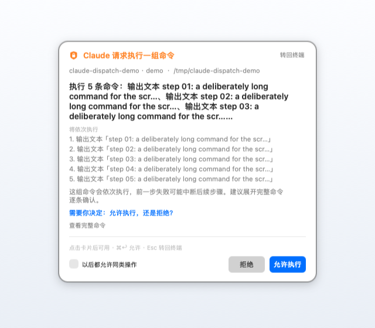
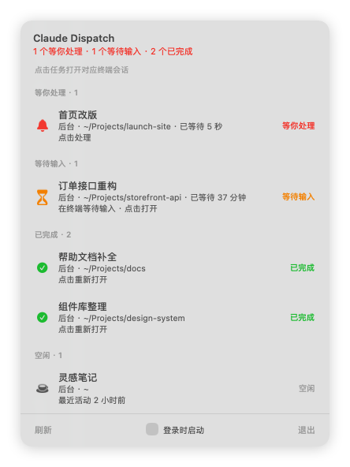
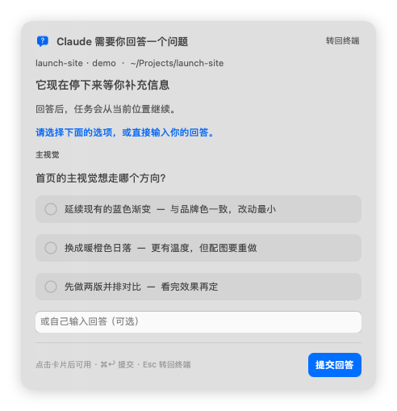
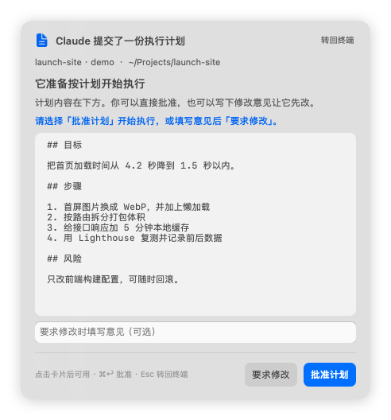
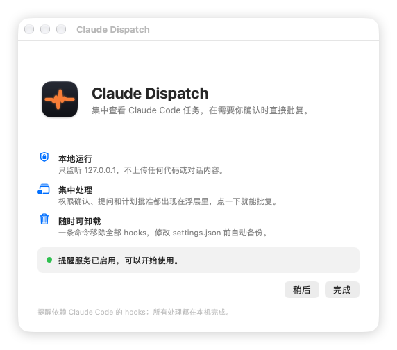

# Claude Dispatch

[English](README.en.md) · 中文

macOS 菜单栏上的 Claude Code 任务调度台：同时盯住多个会话，在任务需要你确认时主动提醒，并让你直接在浮层里批复，不用切回终端。

纯本地运行，不联网、无遥测；不依赖 Claude 账号，用 DeepSeek 等第三方 provider 同样可用。



## 解决什么问题

同时跑多个 Claude Code 任务时，最常见的三个坑：

1. 某个任务卡在权限确认，你没看见，时间白等。
2. Claude 反问你一个问题，你要重新找到那个终端窗口。
3. 想知道「现在到底有几个任务在跑、哪个在等我」。

Claude Dispatch 用一条常驻状态条 + 一块状态面板 + 三类确认浮层解决这三件事。第一次使用，先看下面的「界面一览」，3 分钟就能知道它会在什么时候出现、每种状态是什么意思。

## 界面一览

### 1. 常驻状态条

状态条固定在屏幕右上角（可拖动，位置会记住），只显示**当前最重要的一件事**。它不抢键盘焦点，在所有 Space 和全屏应用上都可见。

| 状态 | 状态条 | 什么时候出现 |
|---|---|---|
| 等你处理 |  | 有权限确认、Claude 提问或计划批准在等你。**这时才需要你动手**，点状态条或直接点浮层卡片。 |
| 运行中 |  | 至少有一个任务在跑，不需要你做任何事。 |
| 等待输入 |  | 终端里的 Claude 在等你输入文字、但 App 没有可展示的卡片（例如 hook 断开或任务在后台等待）。点状态条找到对应会话。 |
| 已完成 |  | 最近结束的任务，保留 10 分钟，方便回看或重新打开。 |
| 空闲 |  | 没有任务在跑，也没有请求等你。 |

状态的优先级从上到下：等你处理 → 等待输入 → 可能卡住 → 运行中 → 已完成 → 空闲。状态条右侧出现**黄点**表示数据源降级（`claude agents` 暂时不可用，正在读会话注册表兜底）。

- 鼠标悬停：展开状态面板；移开自动收起。
- 点击：固定/收起面板。
- 拖动：换位置，下次启动还在原处。
- 菜单栏图标同步显示：有请求时变成红色铃铛和数量，平时显示波形和运行中数量。

### 2. 状态面板（所有会话一眼看清）

点击或悬停状态条展开。会话按状态分组，每行显示项目名、后台/交互式、路径、运行时长和最近活动。



- **等你处理**：有确认卡在队列里，点击行直接打开对应终端。
- **等待输入**：终端自己在等你的文字输入，但 App 里没有卡片可点。
- **可能卡住**：任务在跑，但 5 分钟没有任何活动，提醒你去看看。
- **运行中 / 已完成 / 空闲**：其余会话。
- 点击任意任务行打开对应终端会话：后台任务用 `claude attach`，交互式会话切到对应 Terminal 标签页，已结束的会话用 `claude --resume`。已经开过窗口的任务会直接定位过去，不会重复开新窗口。
- 底栏：刷新数据、开关「登录时启动」、退出 App。

### 3. 确认浮层：权限、提问、计划

三类需要你决策的场景会直接弹在状态条下方。默认只显示**中文人话**：要做什么、有什么影响、你要决定什么；原始命令收在「查看完整命令」里。

#### 权限确认


- 显示中文动作摘要和风险说明（安装依赖、删除文件、推送代码等）。
- 「拒绝」或「允许执行」；想核对原文时点「查看完整命令」。
- 「以后都允许同类操作」也必须由你显式勾选，不会静默放行。

#### Claude 提问



- 单选直接点；多选可勾多个；选项下方带一句说明。
- 也可以不选选项，直接在输入框里写自己的回答。
- 一个问题或多个问题、内容超长时会自动滚动，提交按钮固定在底部。

#### 计划批准



- 计划正文可滚动查看，步骤多也不会把按钮挤出屏幕。
- 直接「批准计划」，或填写意见后「要求修改」。

#### 三类卡片共有的交互

- **多个请求排队**：一次显示一张卡，顶部 chips 切换；切换不丢失已填内容。
- **快捷键**：点击卡片使其获得焦点后，`⌘↩` 允许/提交，`Esc` 转回终端。
- **转回终端**：点右上角「转回终端」或按 `Esc`，决策回到 Claude Code 原生弹窗。
- **提醒升级**：15 秒未处理会脉冲并再响一次；45 秒抬到最前，并移动到鼠标所在屏幕。始终不抢键盘焦点。
- **长内容**：卡片高度限制在屏幕内，正文滚动，底部按钮始终可见。

### 4. 首次启动引导



首次打开会安装 Claude Code hooks，并检查是否装好。看到「提醒服务已启用」即可开始使用；已经在跑的 Claude Code 会话需要重启后才会加载新 hooks。之后如果 cc-switch 等工具重写了 `settings.json`，状态条会变成「提醒服务异常 · 点击修复」，点一下即可恢复。

## 系统要求

- macOS 14 Sonoma 或更高
- Apple Silicon 或 Intel（通用二进制）
- 已安装并可使用 [Claude Code](https://claude.com/claude-code)

> v1.1.0 的应用界面为中文。

## 安装

### 下载安装（推荐）

1. 到 [Releases](https://github.com/ink110/claude-dispatch/releases/latest) 下载 `ClaudeDispatch-1.1.0.zip`。
2. 解压，把 `ClaudeDispatch.app` 拖进「应用程序」。
3. **首次打开必须右键 →「打开」**。应用没有 Apple 开发者签名，双击会被 Gatekeeper 拦下。

   如果仍然提示无法打开，到「系统设置 → 隐私与安全性」点「仍要打开」；或在终端执行：

   ```bash
   xattr -dr com.apple.quarantine /Applications/ClaudeDispatch.app
   ```

4. 首次启动会出现引导窗口，点「完成」即可启用提醒。正在运行的 Claude Code 会话需要重启后才会加载新 hooks。

也可以校验下载包的 SHA-256（Release 页面会同时提供 `.sha256`）：

```bash
shasum -a 256 -c ClaudeDispatch-1.1.0.zip.sha256
```

### 从源码构建

要求 Xcode Command Line Tools（`swiftc`），不需要 Homebrew、jq 或第三方依赖。

```bash
git clone https://github.com/ink110/claude-dispatch.git
cd claude-dispatch
./scripts/install.sh
```

`install.sh` 会编译通用二进制、安装到 `~/Applications/ClaudeDispatch.app`、写入 hooks（自动备份 `~/.claude/settings.json`）并启动应用。

## 操作速查

| 你想做的事 | 怎么做 |
|---|---|
| 看看现在有几个任务 | 看右上角状态条 |
| 找到某个会话 | 悬停/点击状态条，在面板里点对应行 |
| 处理权限/提问/计划 | 直接在卡片上点，或点卡片后按 `⌘↩` |
| 不在这儿处理 | 点「转回终端」或按 `Esc` |
| 多个请求切换 | 点卡片顶部的 chips |
| 换状态条位置 | 直接拖动 |
| 关掉登录自启 | 状态面板底部复选框 |
| hooks 失效 | 状态条显示「点击修复」时点一下 |

### 控制「终端」的自动化权限（可选）

点击任务卡片时，精确定位到已打开的 Terminal 标签页需要「控制终端」权限。第一次定位失败时 App 会主动弹一次授权框；允许后每次点击都会精确选中对应标签页。不授权也能用：只会把 Terminal 切到前台，不会开重复窗口，`claude attach` 不受影响。

如果授权弹窗没有出现，可主动调出：

```bash
open -n /Applications/ClaudeDispatch.app --args --request-automation
```

## 隐私与安全

- hook 服务只绑定 `127.0.0.1:18765`，所有请求都校验本机随机 token（`~/.claude-dispatch/token`，权限 600）。
- 不联网、无遥测、不上传代码或对话内容。
- 只修改 Claude Code 的 `~/.claude/settings.json` 中的 hooks 字段，每次修改前自动备份（保留最近 5 份）。
- 不会静默批准任何操作；「以后都允许同类操作」也必须由你点击。
- App 未运行、超时或返回错误时，Claude Code 自动回落到终端原生确认，不会把任务卡死。

## 工作原理

```
Claude Code 会话
  ├─ claude agents --json ──每 5 秒──> 状态条 / 状态面板（主数据源）
  │    └─ 连续失败 → 降级读 ~/.claude/sessions/<pid>.json
  └─ hooks ──HTTP POST──> 127.0.0.1:18765 ──> 浮层 ──> 返回 allow / deny / 答案
```

| Hook 事件 | 作用 |
|---|---|
| `PermissionRequest` | 权限确认、计划批准；浮层阻塞等待选择 |
| `PreToolUse`（`AskUserQuestion`） | 回答问题，返回 `updatedInput.answers` |
| `PreToolUse` / `PostToolUse`（`*`，`mode=activity`） | 记录「正在做什么」，只记录、不决策 |
| `Stop` | 一轮回复结束，只更新活动 |
| `Notification` | 等待输入、后台任务完成提醒 |
| `SessionStart` / `SessionEnd` | 刷新状态与「最近完成」列表 |

## 限制

- 只处理需要你决策的环节：权限、提问、计划批准。想让 Claude 凭空开始一个新任务，请回终端。
- 同一时间显示一张确认卡，多个请求排队；卡片顶部 chips 可切换，切换不丢已填内容。
- 「计划批准」是尽力而为：部分 Claude Code 版本/模式下 `ExitPlanMode` 由终端 TUI 自己处理，此时仍回落到终端。
- 应用未公证，首次打开需要右键或手动放行。
- 数据源优先使用官方 `claude agents --json`；Claude Code 大版本升级后接口若有变化，状态条可能显示数据降级。

## 卸载

```bash
# 按实际安装位置调整（下载安装通常在 /Applications，源码安装脚本装在 ~/Applications）
/Applications/ClaudeDispatch.app/Contents/MacOS/ClaudeDispatch --uninstall-hooks
```

这会移除全部 Claude Dispatch hooks 并备份 settings。然后把 `ClaudeDispatch.app` 移到废纸篓，并在「系统设置 → 通用 → 登录项」中移除 Claude Dispatch。

## 开发

```bash
./scripts/build.sh          # 编译 arm64 + x86_64 通用二进制
./scripts/test-humanizer.sh # Humanizer 纯函数测试
./scripts/smoke.sh          # curl + /status 冒烟测试（App 需运行）
./scripts/demo-request.sh   # 注入合成的长提问卡，验证滚动与固定按钮
./scripts/package.sh        # 生成 dist/ClaudeDispatch-<version>.zip + SHA-256
```

截图/文档模式：`CLAUDE_DISPATCH_DEMO_AGENTS=<agents.json> CLAUDE_DISPATCH_SHOW_FLOATING_STATUS=1 build/ClaudeDispatch.app/Contents/MacOS/ClaudeDispatch` 用固定的演示会话展示状态面板，不读取本机真实会话。

Swift + AppKit，零第三方依赖。源码结构与设计约定见 [CLAUDE.md](CLAUDE.md)。

## 许可证

[MIT](LICENSE) © 2026 ink

Claude 是 Anthropic 的商标。本项目是独立的社区工具，与 Anthropic 没有隶属或背书关系。
